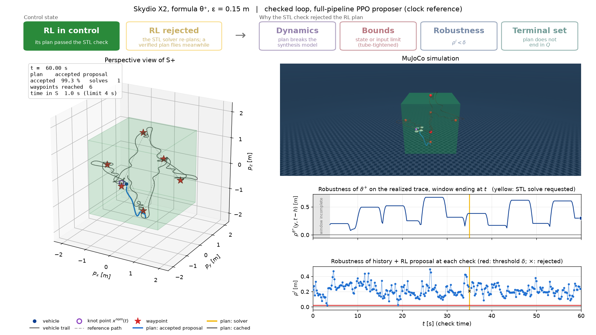
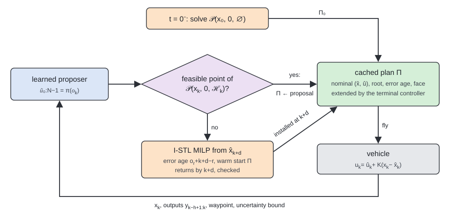

<p align="center">
  
</p>

# LIRRA: Learning-Augmented Interval-STL for Recursively-feasible Runtime Assurance

[](https://hub.docker.com/r/evannsmc/lirra)
[](https://evannsmc.github.io/rl-stl/)
[](https://www.evannsmc.com)

Code for the paper **Skip the Solve: Learned Trajectory Proposals for Recursively Feasible
Interval-STL Runtime Assurance** by Evanns Morales-Cuadrado, Xinpei Ni, Glen Chou and Samuel Coogan
(Georgia Institute of Technology), submitted to L4DC 2027.

The project website, with the theory, all results and videos of every specification, is
[evannsmc.github.io/rl-stl](https://evannsmc.github.io/rl-stl/).

**LIRRA** lets a vehicle skip most of the expensive signal temporal logic (STL) synthesis it would
otherwise solve online, without giving up its safety guarantee. At every planning step a learned
policy proposes a whole trajectory in about a millisecond. The proposal is accepted only if it
satisfies every constraint of the interval-STL synthesis problem, including control-invariant
terminal sets. If it is rejected, the vehicle keeps flying its last verified plan while synthesis
runs from the state the vehicle will reach when the solver finishes. Satisfaction and recursive
feasibility therefore hold for any proposer and any solver completion time, while the solver is
needed on only a few percent of planning steps.

<p align="center">
  <br>
  <em>Skydio X2 (MuJoCo) patrolling around the keep-out cube under LIRRA. Left: top-down view and the
  plan in force (blue: accepted proposal, orange: solver, grey: cached). Right: MuJoCo view, the
  realized robustness, and the robustness of each proposal. Videos of all eight specifications are on
  the <a href="https://evannsmc.github.io/rl-stl/case_studies.html">project site</a>.</em>
</p>

<p align="center">
  
</p>

## Results at a Glance

Always-on interval-STL runtime assurance (synthesis at every step) against LIRRA, 30 episodes per
row, on the paper's four specifications around a 3-D keep-out cube (θ: leave within 4 s; φ: leave
within 3 s and stay out 1 s; ⁺: uncertain cube boundaries).

| System | Spec. | LIRRA fallbacks / step | Time I-STL [ms/step] | Time LIRRA [ms/step] | Violations |
|---|---|---|---|---|---|
| Skydio X2 | θ | .006 | 140.9 | 1.7 | 0/30 |
| | φ | .007 | 151.5 | 2.0 | 0/30 |
| | θ⁺ | .013 | 158.8 | 3.1 | 0/30 |
| | φ⁺ | .011 | 151.2 | 3.0 | 0/30 |
| Blimp (GT-MAB) | θ | .062 | 10.9 | 1.7 | 0/30 |
| | φ | .045 | 12.1 | 1.8 | 0/29 |
| | θ⁺ | .077 | 11.7 | 2.2 | 0/30 |
| | φ⁺ | .041 | 14.0 | 1.9 | 0/23 |

The [case studies](https://evannsmc.github.io/rl-stl/case_studies.html) page has all eight
specifications (square and cube, exact and uncertain boundaries), the ablations and the videos.

## Quick Start with Docker

All experiments run in a Docker image with every dependency installed: Python 3.12, MuJoCo/MJX,
MuJoCo Playground, Brax, JAX, `stlpy` and Gurobi.

### Option A: Pre-built Image (Fastest)

```bash
git clone https://github.com/evannsmc/lirra.git && cd lirra/docker
make pull             # pulls evannsmc/lirra:latest from Docker Hub
make run              # starts the container with the repository mounted
```

### Option B: Build from Source

```bash
git clone https://github.com/evannsmc/lirra.git && cd lirra/docker
make build
make run
```

### Gurobi Licence

The synthesis problems of the Skydio X2 and the blimp are larger than Gurobi's free size-limited
licence allows. Academics can get a free **Web License Service (WLS)** licence from Gurobi, which
works inside containers (machine-locked named-user licences do not). Save it as
`~/gurobi.lic`; `make run` mounts it into the container.

### Reproduce a Result

```bash
make test                                  # unit tests
make eval SYS=x2 SPEC=theta_plus           # I-STL vs LIRRA vs unchecked proposer, 30 episodes
make video SYS=x2 SPEC=theta_plus          # render one episode (top-down + MuJoCo composite)
make table                                 # rebuild the results tables from your evaluations
```

See [`docker/README.md`](docker/README.md) for every target, including the full training pipeline
(expert data, behavior cloning, DAgger, margin-weighted cloning, PPO) and the paper's evaluations.

## Without Docker

```bash
./setup.sh                   # uv environment; CUDA 12 JAX if a GPU is visible, otherwise CPU
source .venv/bin/activate
uv run pytest -n 8 -m "not slow"
```

The [installation page](https://evannsmc.github.io/rl-stl/installation.html) lists every pipeline
stage and option.

## Repository Layout

| Path | Contents |
|---|---|
| `src/rl_stl/` | I-STL synthesis (Gurobi MILP), verification, terminal sets, error-age tubes, runtime loop, proposer, vehicle models |
| `experiments/patrol/` | datasets, behavior cloning, PPO, evaluation, rendering and result tables |
| `scripts/` | the DAgger, margin-weighted cloning and PPO pipeline |
| `policies/` | trained proposers behind the paper's results, one per system and specification |
| `tests/` | unit tests |
| `docker/` | Dockerfile and `make` targets |

## Citation

```bibtex
@inproceedings{moralescuadrado2027skip,
  title     = {Skip the Solve: Learned Trajectory Proposals for Recursively Feasible
               Interval-{STL} Runtime Assurance},
  author    = {Morales-Cuadrado, Evanns and Ni, Xinpei and Chou, Glen and Coogan, Samuel},
  booktitle = {Learning for Dynamics and Control Conference (L4DC)},
  year      = {2027},
  note      = {Under review}
}
```

## License

MIT
